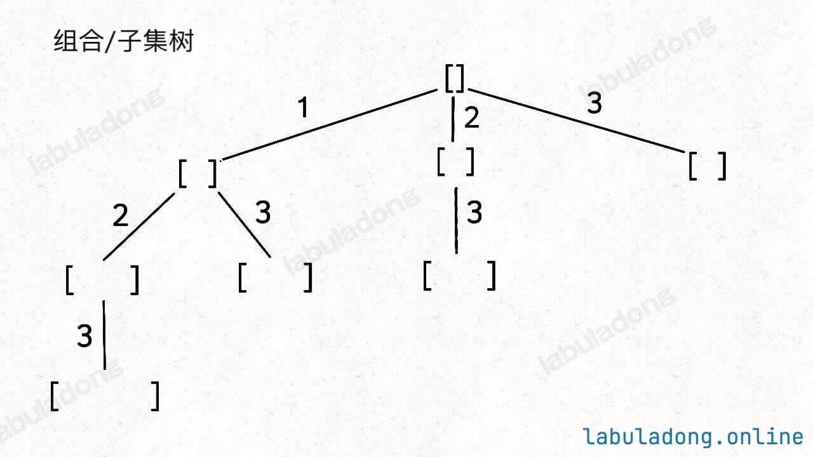
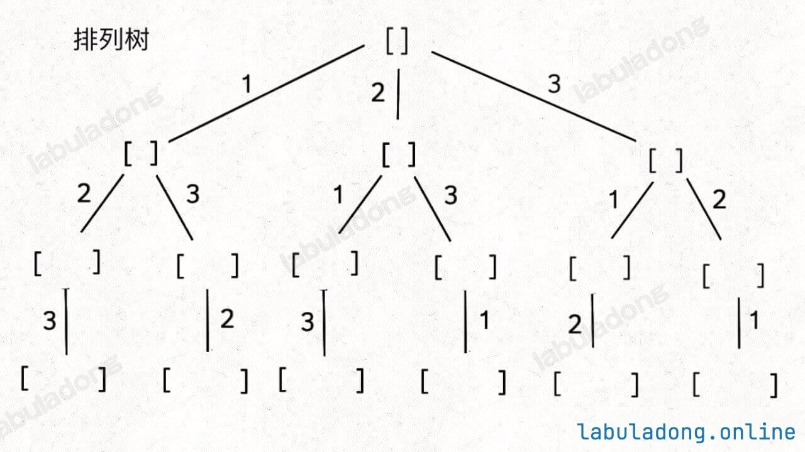

# 1 总领

## 1.1 问题分类

无论是排列、组合还是子集问题，简单说无非就是让你从序列 nums 中以给定规则取若干元素，主要有以下几种变体：

**形式一、元素无重、不可复选，即 nums 中的元素都是唯一的，每个元素最多只能被使用一次，这也是最基本的形式。**

以组合为例，如果输入 nums = [2,3,6,7]，和为 7 的组合应该只有 [7]。

**形式二、元素可重、不可复选，即 nums 中的元素可以存在重复，每个元素最多只能被使用一次。**

以组合为例，如果输入 nums = [2,5,2,1,2]，和为 7 的组合应该有两种 [2,2,2,1] 和 [5,2]。

**形式三、元素无重、可复选，即 nums 中的元素都是唯一的，每个元素可以被使用若干次。**

以组合为例，如果输入 nums = [2,3,6,7]，和为 7 的组合应该有两种 [2,2,3] 和 [7]。

当然，也可以说有第四种形式，即元素可重可复选。但既然元素可复选，那又何必存在重复元素呢？元素去重之后就等同于形式三，所以这种情况不用考虑。

上面用组合问题举的例子，但**排列、组合、子集问题都可以有这三种基本形式，所以共有 9 种变化**。

除此之外，题目也可以再添加各种限制条件，比如让你求和为 target 且元素个数为 k 的组合，那这么一来又可以衍生出一堆变体，怪不得面试笔试中经常考到排列组合这种基本题型。

但无论形式怎么变化，其本质就是穷举所有解，而这些解呈现树形结构，所以合理使用回溯算法框架，稍改代码框架即可把这些问题一网打尽。

消化下面2张树形图，就能解决所有问题：





首先，组合问题和子集问题其实是等价的，这个后面会讲；至于之前说的三种变化形式，无非是在这两棵树上剪掉或者增加一些树枝罢了。

## 1.2 关键问题

**第一**，关于backtrack这个函数，backtrack(状态) 是一个"负责把当前节点整棵子树遍历完"（也就是每条path上的答案）的函数。

```python
def backtrack(状态):
    # ① base case：什么时候到叶子，收集答案
    if 到达叶子:
        ans.append(路径快照)
        return

    # ② 枚举孩子：从当前节点能走到哪些下一层
    for 每个可选的孩子:
        做出选择（改状态）
        backtrack(下一层状态)   # ③ 回溯：递归遍历孩子子树
        撤销选择（还原状态）
```


**第二**，为什么叫"回溯"？

名字来自那个"撤销选择"的动作。看这个执行过程：进入节点 → 做选择 → 深入孩子 → ... → **退回 → 撤销选择 → 换下一个孩子**

递归"深入"到叶子后，函数返回，状态要还原到进入前的样子，才能干净地试下一个分支。这个"退回来、把刚才改的东西改回去"的过程，就是回溯（backtrack）。

面试常问"回溯和 DFS 什么区别"：DFS 是遍历方式，回溯是"**在 DFS 过程中维护路径 + 撤销选择**"的算法思想，本质是带状态恢复的 DFS。


**第三**，组合和排列题的backtrack函数区别

组合题：选过的元素不能再选，且顺序无关（[1,2] 和 [2,1] 算同一个），所以用 start 保证只往后选、下标递增。

排列题：顺序有关（[1,2] 和 [2,1] 是两个答案），每个元素每一层都可能被选，只要它"还没被用过"。用 start 递增会把 [2,1] 这种"回头选"的排列全部漏掉。

# 2 元素无重不可复选

## 2.1 子集

**例题[【hot 100】子集.md]**：https://labuladong.online/zh/problem/leetcode/subsets/description/

代码展示如下：

```python
class Solution:
    def subsets(self, nums):
        ans = []
        path = [] # 记录每一个子集（每一条回溯路径）

        def backtrack(start): # 决定路径的开始索引，需要找nums[start……]的子集
            ans.append(path[:]) # 空集也是子集
            for i in range(start, len(nums)):
                path.append(nums[i])
                backtrack(i + 1)
                path.pop()
            
        backtrack(0)
        return ans
```

**例题[【hot 100】电话号码的字母组合.md]**：https://labuladong.online/zh/problem/leetcode/letter-combinations-of-a-phone-number/description/

代码展示如下：

```python
class Solution:
    def letterCombinations(self, digits):
        # 特殊情况
        if not digits:
            return []

        hashmap = [
            "", "", "abc", "def", "ghi", "jkl", "mno", "pqrs", "tuv", "wxyz"
        ] # 不用写key，用list的索引下标对应即可
        
        ans = []
        path = []
        k = len(digits)

        # backtrack函数的作用：backtrack(状态) = 在当前这个状态下，把从它出发的所有可能结果都收集完
        # 对于这道题而言，需要的状态就是digits的每个元素数字
        def backtrack(idx): 
            # base case
            if len(path) == k:
                ans.append(''.join(path))
                return

            digit = int(digits[idx]) # 索引idx -> 数字digit
            for ch in hashmap[digit]: # 遍历这个数字对应的所有字母
                path.append(ch)
                backtrack(idx + 1) # 处理下一个数字
                path.pop()

        backtrack(0)
        return ans
```

## 2.2 组合

## Problem
https://leetcode.cn/problems/combinations/description/

## Problem Description
给定两个整数 n 和 k，返回范围 [1, n] 中所有可能的 k 个数的组合。你可以按 任何顺序 返回答案。

## Solution

如果你能够成功的生成所有无重子集，那么你稍微改改代码就能生成所有无重组合了。你比如说，让你在 nums = [1,2,3] 中拿 2 个元素形成所有的组合，你怎么做？稍微想想就会发现，大小为 2 的所有组合，不就是所有大小为 2 的子集嘛。

所以我说**组合和子集是一样的：大小为 k 的组合就是大小为 k 的子集**。

还是以 nums = [1,2,3] 为例，刚才让你求所有子集，就是把所有节点的值都收集起来；现在你只需要把第 2 层（根节点视为第 0 层）的节点收集起来，就是大小为 2 的所有组合：

怎么求i的取值？

```python
站在当前节点，path 里已有 len(path) 个元素，还差 need = k - len(path) 个才能凑满（最少要 need 个）

假设这一轮从下标 i 开始选，那么可选的下标是 i, i+1, ..., len(nums)-1，一共：(len(nums) - 1) - i + 1 = len(nums) - i 个元素。

所以 len(nums) - i >= need

解出 i：i <= len(nums) - need = len(nums) - (k - len(path))
```

**注意：这道题也可以不剪枝，直接for i in range(start, len(nums))，因为有了base case的if len(path) == k:答案同样正确**

代码展示如下：

```python
# 比如n=4,k=2,在[1,2,3,4]中所有个数为2的组合

class Solution:
    def combine(self, n, k):
        nums = []
        for i in range(1, n + 1):
            nums.append(i)
        ans = []
        path = []

        def backtrack(start): # 只能找长度为k的path
            # base case
            if len(path) == k:
                ans.append(path[:])
                return 

            for i in range(start, len(nums) - (k - len(path)) + 1): # 剪枝：剩下元素不够凑满k个，直接不试
                path.append(nums[i])
                backtrack(i + 1)
                path.pop()

        backtrack(0)
        return ans
```


## 2.3 排列

刚才讲的**组合/子集问题使用 start 变量保证元素 nums[start] 之后只会出现 nums[start+1..] 中的元素，通过固定元素的相对位置保证不出现重复的子集**。

但**排列问题本身就是让你穷举元素的位置，nums[i] 之后也可以出现 nums[i] 左边的元素，所以之前的那一套玩不转了，需要额外使用 used 数组来标记哪些元素还可以被选择**。

例题[【hot 100】全排列.md]：https://labuladong.online/zh/problem/leetcode/permutations/description/

代码展示如下：

```python
class Solution:
    def permute(self, nums):
        if not nums:
            return []
            
        ans = []
        path = []
        used = [False] * len(nums) # 标记每个元素是否已被选

        def backtrack():
            # base case
            if len(path) == len(nums):
                ans.append(path[:]) # 深拷贝，一定要path[:]
                return

            for i in range(len(nums)):
                if used[i]: # base case,已经用过了
                    continue
                used[i] = True # 对nums[i]进行标记，使用过了
                path.append(nums[i])
                backtrack()
                path.pop()
                used[i] = False

        backtrack()
        return ans
```

# 3 有重复元素、不可复选
## 3.1 子集/组合

本质和无重复元素不复选没有区别，难点在于每个具体问题的backtrack怎么写：

**【hot 100】括号生成**

**【hot 100】分割回文串**

## 3.2 排列

**【hot 100】N皇后**


# 4 元素无重、可复选
## 排列

**【hot 100】组合总和**

和之前的做法区别在于，backtrack回溯的时候还是从i开始、而非i+1
