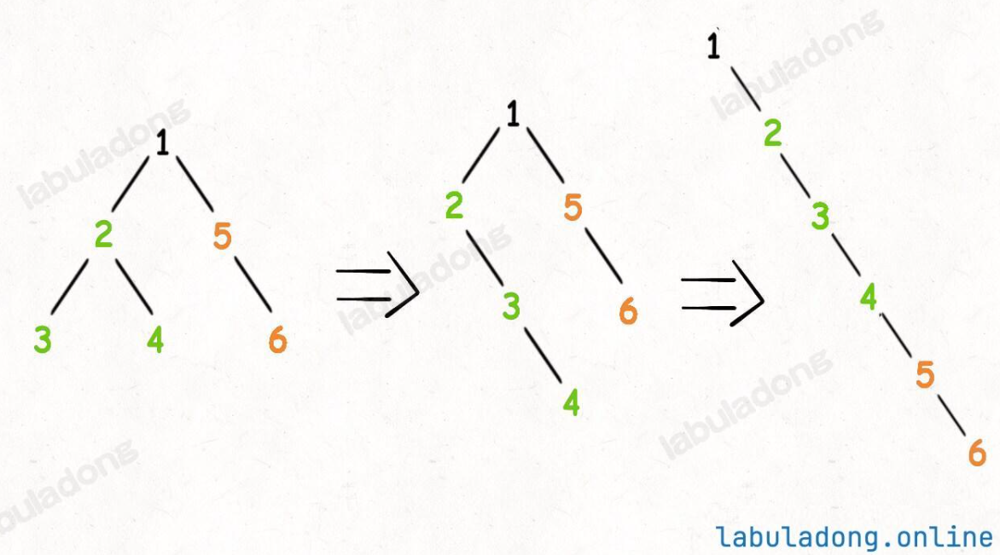

# Problem
https://labuladong.online/zh/problem/leetcode/flatten-binary-tree-to-linked-list/description/


# Problem Description
给你二叉树的根结点 root，请你将它原地展开为一个单链表：

展开后的单链表应该同样使用 TreeNode，其中 right 子指针指向链表中下一个结点，而左子指针 left 始终为 null。

展开后的单链表应该与二叉树先序遍历顺序相同。


# Solution
可以使用递归的思维：

对于每一个节点 x，可以先利用 flatten(x.left) 和 flatten(x.right) 将 x 的左右子树拉平；然后将整个左子树作为右子树，然后将原先的右子树接到当前右子树的末端。



# Code

## LC version

```python
class Solution:
    def flatten(self, root: TreeNode | None) -> None:
        if root is None:
            return None
        
        # 先展平左右子树
        self.flatten(root.left)
        self.flatten(root.right)

        # 取root的左右孩子
        left = root.left
        right = root.right
        # 左孩子放到right，左子树没东西
        root.right = left
        root.left = None
        
        # 上面只处理了左子树，原来的右子树和root分离了！所以要往下面迭代，直到原来left的最后一个节点连上right
        p = root
        while p.right:
            p = p.right
        p.right = right
```

# Complexity Analysis
- 时间复杂度：O(n)
- 空间复杂度：O(1)
