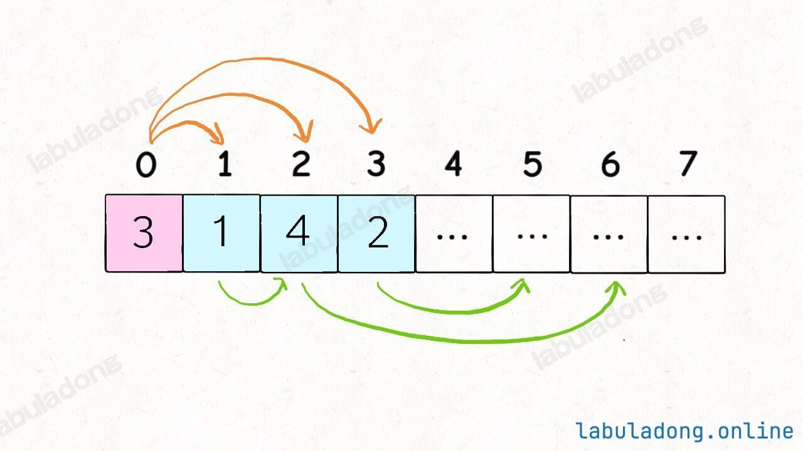

# Problem
https://labuladong.online/zh/problem/leetcode/jump-game-ii/description/


# Problem Description
给定一个长度为 n 的 从 0 开始 的非负整数数组 nums。初始位置为 nums[0]。

每个元素 nums[i] 表示从索引 i 向前跳转的最大长度。换句话说，如果你在 nums[i] 处，你可以跳转到任意 nums[i + j] 处:

0 <= j <= nums[i]

i + j < n

**（保证一定可以跳到最后一格）返回到达 nums[n - 1] 的最小跳跃次数**。生成的测试用例可以到达 nums[n - 1]。


# Solution
常规的思维就是暴力穷举，把所有可行的跳跃方案都穷举出来，计算步数最少的。穷举的过程会有重叠子问题，用备忘录消除一下，就成了自顶向下的动态规划（时间复杂度为O(n^2)，n比较大的时候会超时）。

```python
# dp[i]=跳到nums[i]的最小跳跃次数
# dp[i] = min(dp[i], dp[j] + 1)；对所有 j < i 且 j + nums[j] >= i

class Solution:
    def jump(self, nums):
        n = len(nums)
        dp = [float('inf')] * n
        dp[0] = 0
        
        for i in range(1, n):
            for j in range(i):
                if j + nums[j] >= i:
                    dp[i] = min(dp[i], dp[j] + 1)
                    
        return dp[n - 1]
```

不过直观地想一想，似乎不需要穷举所有方案，只需要判断哪一个选择最具有「潜力」即可，这就是贪心思想来做，比动态规划效率更高。



比如上图这种情况，我们站在索引 0 的位置，可以向前跳 1，2 或 3 步，你说应该选择跳多少呢？

显然应该跳 2 步调到索引 2，因为 nums[2] 的可跳跃区域涵盖了索引区间 [3..6]，比其他的都大。

这就是思路，我们用 i 和 end 标记了可以选择的跳跃步数，farthest 标记了所有选择 [i..end] 中能够跳到的最远距离，jumps 记录跳跃次数。


# Code

## LC version

```python
class Solution:
    def jump(self, nums):
        n = len(nums)
        if n <= 1:
            return 0
        
        steps = 0
        end = 0 # 这一跳的最远边界
        farthest = 0 # 下一跳的最远边界

        for i in range(0, n - 1): # n-2不用管
            farthest = max(farthest, i + nums[i])
            if i == end: # 这一跳已极限
                steps += 1
                end = farthest # 递归到下一跳
                if end >= n - 1: # 可以覆盖所有nums
                    break 

        return steps
```

# Complexity Analysis
- 时间复杂度：O(n)
- 空间复杂度：O(1)
