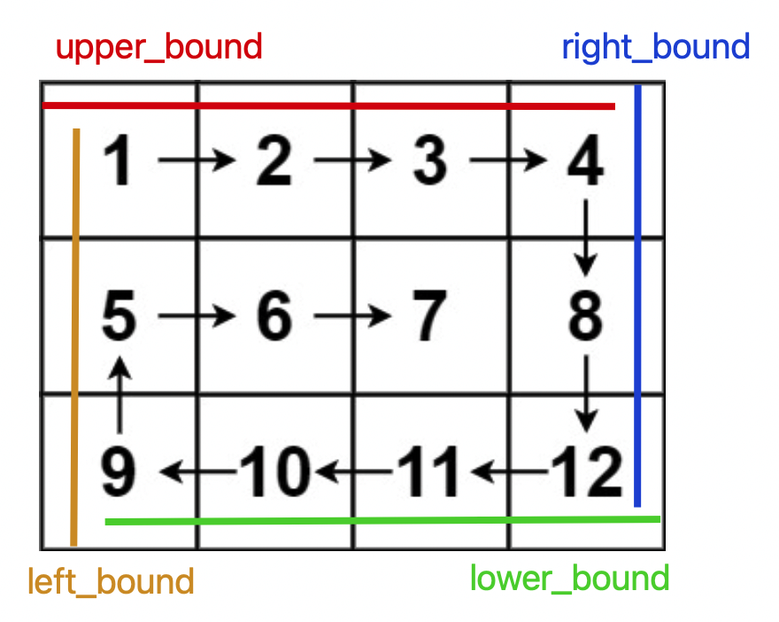

# Problem
https://labuladong.online/zh/problem/leetcode/spiral-matrix/description/


# Problem Description
给你一个 m 行 n 列的矩阵 matrix，请按顺时针螺旋顺序返回矩阵中的所有元素。

螺旋顺序的遍历方向依次为：从左到右 → 从上到下 → 从右到左 → 从下到上，由外向内不断收缩。

# 第三轮注意点
1. 循环条件是while len(ans) < m * n:，不是<=，因为最后一次恰好条件不成立、再做一次循环，如果<=存在最后一次运行的不必要、逻辑冗余
```python
while 还没收集完 (len(ans) < m*n):
    收集一圈
```

2. 设定四个边界保证i/j在这个范围之内，其中j的范围是left-right（两端可取），i的范围是upper-lower（两端可取）

# Solution

确定边界upper/lower/left/right，不断缩小边界来遍历，注意矩阵问题都可以考虑**矩阵坐标 matrix[i][j]**



# Code


## ACM version


```python
import sys 


class Solution:
    def rollMatrix(self, matrix):
        m, n = len(matrix), len(matrix[0])
        ans = []
        upper , lower = 0, m - 1
        left, right = 0, n -1
        
        while len(ans) < m * n: # ans遍历完应该长度为mn
            if upper <= lower: # 遍历行
                for j in range(left, right + 1):
                    ans.append(matrix[upper][j])
                upper += 1

            if left <= right: # 遍历列
                for i in range(upper, lower + 1):
                    ans.append(matrix[i][right])
                right -= 1

            if upper <= lower:
                for j in range(right, left - 1, -1): # 最小遍历到left，所以右边界是left-1；倒序遍历
                    ans.append(matrix[lower][j])
                lower -= 1

            if left <= right:
                for i in range(lower, upper - 1, -1): # 倒序遍历
                    ans.append(matrix[i][left])
                left += 1
                
        return ans # ans已经是['1','2'……]
 

data = sys.stdin.read().strip().split('\n')
idx = 0
while idx < len(data):
    m, n = map(int, data[idx].split()); idx += 1 # ['3','4']
    matrix = []
    for _ in range(m):
        matrix.append(list(map(int, data[idx].split())))
        idx += 1
    result = Solution().rollMatrix(matrix)
    print(' '.join(map(str, result)))
```


# Complexity Analysis
- 时间复杂度：O(mn)
- 空间复杂度：O(1)
